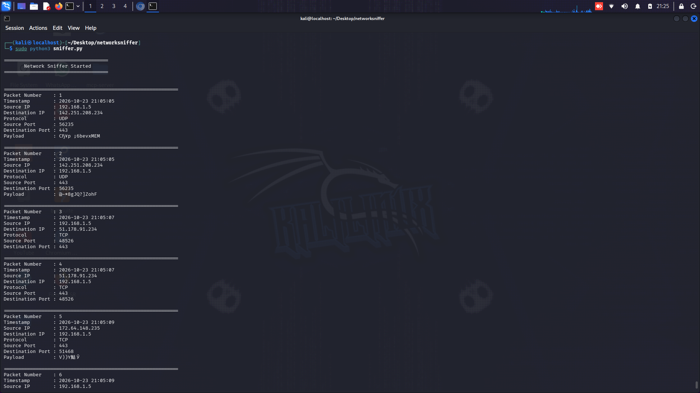

# Network Sniffer

## Overview
Network Sniffer is a cybersecurity project developed using Python and Scapy. The main purpose of this tool is to capture and analyze network packets passing through a network interface.

This project demonstrates the basic concept of network traffic analysis and packet inspection, which is an important skill in cybersecurity, penetration testing, and network security monitoring.

## Description
The tool captures live network packets and extracts useful information from them, including packet number, timestamp, and communication protocol.

It helps in understanding how data moves across networks and provides a practical introduction to concepts such as packet analysis, network protocols, and traffic monitoring.



## Features
- Capture live network packets from the network interface.
- Analyze captured packets using Scapy.
- Identify common network protocols such as:
  - TCP
  - UDP
  - ICMP
- Display packet information in the terminal.
- Record captured packet details into a text file for later analysis.
- Add timestamps to captured packets for tracking network activity.

## How It Works
The tool uses the Scapy library to listen for network traffic. When a packet is detected, the program analyzes the packet structure and extracts important information.

The captured data includes:
- Packet number
- Capture time
- Protocol type
- Basic packet details

After analysis, the information is displayed and saved for future review.

## Technologies Used
- Python
- Scapy Library
- Kali Linux

## Installation

Install the required dependency:

```bash
pip install scapy
```

## Usage

Run the script:

```bash
python network_sniffer.py
```

The program will start capturing packets and displaying the collected information.

## Security Purpose
Network sniffing is an important concept in cybersecurity. Security professionals use packet analysis tools to:

- Monitor network traffic
- Detect suspicious activities
- Troubleshoot network problems
- Understand communication between systems
- Support security investigations

This project was created for educational purposes to practice network security concepts.

## Project Structure

```
Network-Sniffer/
│
├── network_sniffer.py
├── packets.txt
└── README.md
```

## Future Improvements
Possible improvements for this project:

- Add packet filtering options.
- Add a graphical user interface (GUI).
- Export reports in different formats.
- Add more advanced packet analysis features.

## Author

Sayed Samy

Cybersecurity Student
